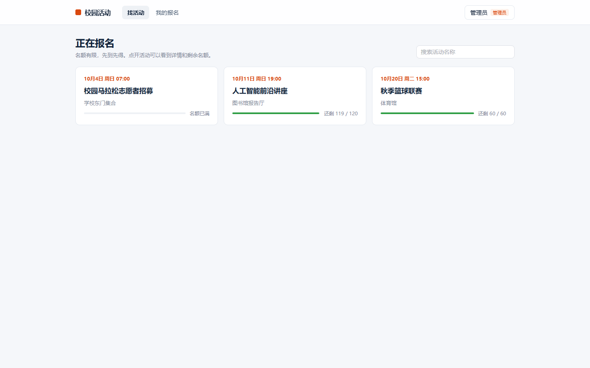
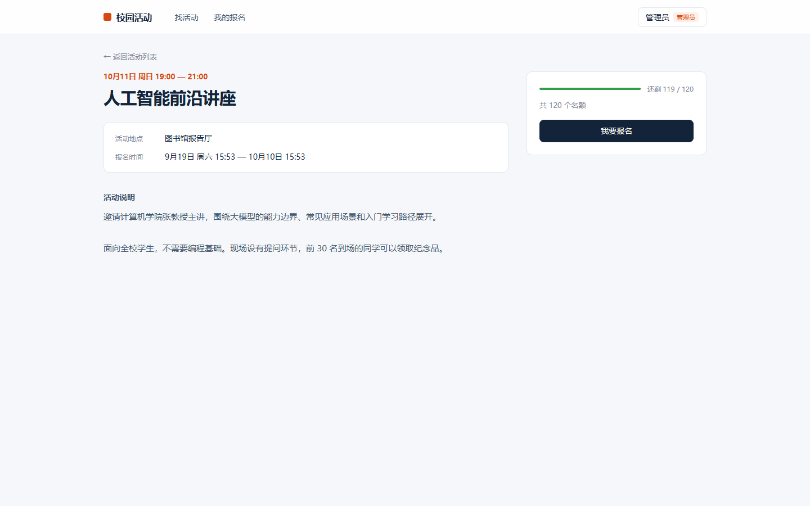
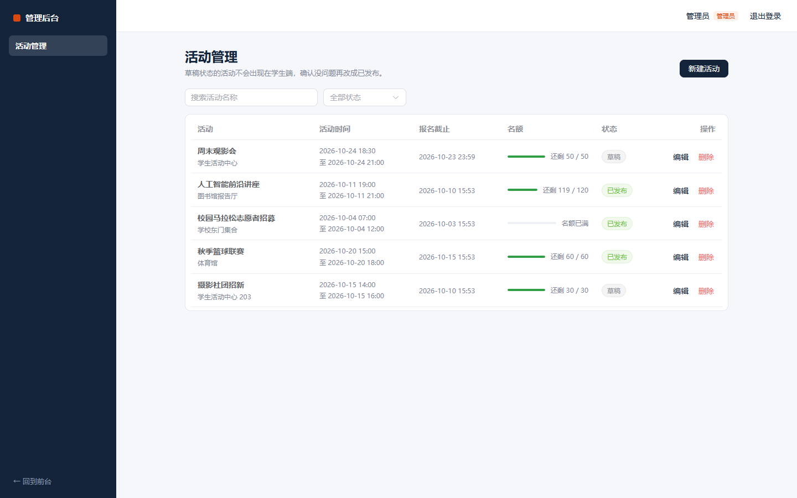
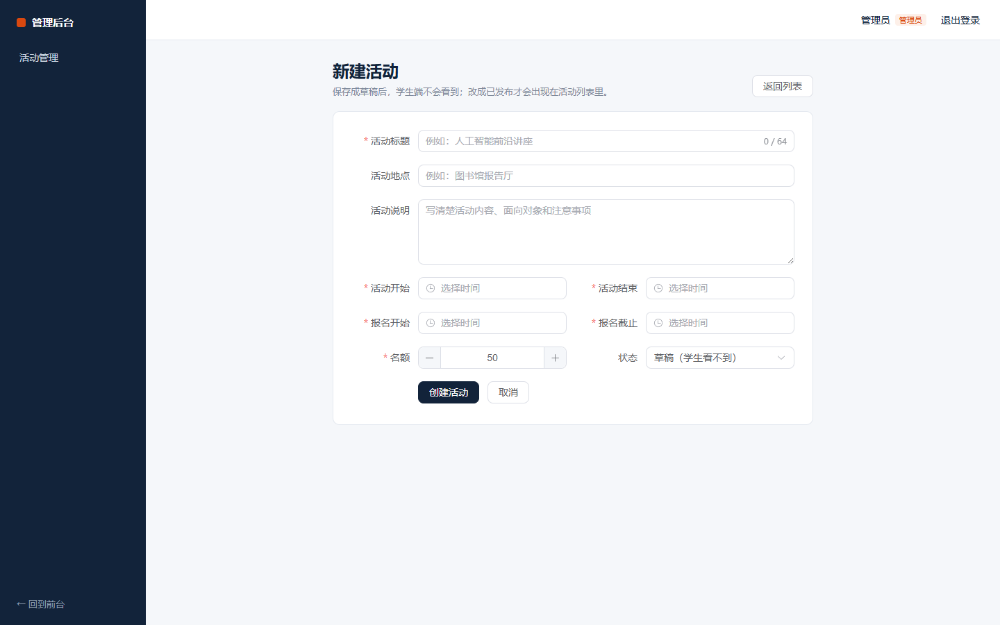
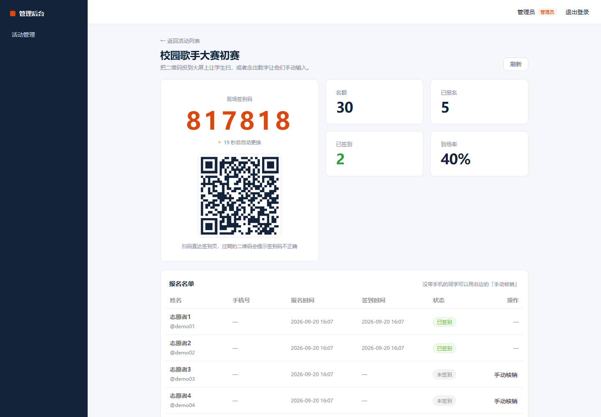
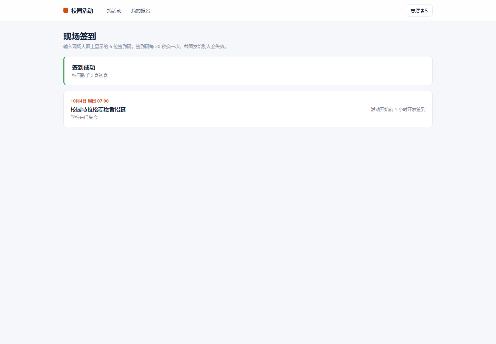
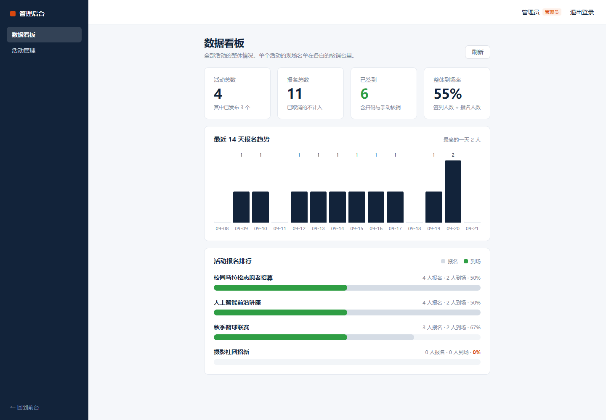
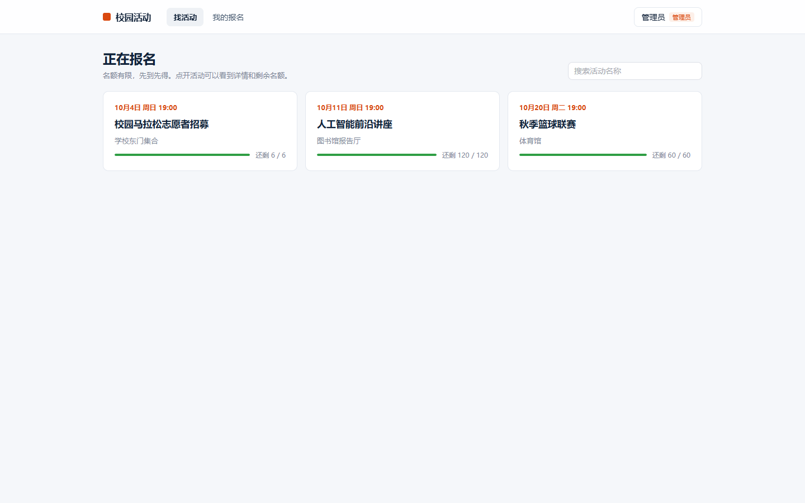

# 校园活动报名与签到平台

一个从零手写、可部署的前后端分离项目。核心是一条完整闭环：**发布活动 → 抢占名额 → 扫码签到 → 数据看板**。

项目重点不在功能数量，而在"抢名额"这一段的并发与一致性处理——这是后端面试最容易被追问、也最容易露怯的地方。

**实测数据**：1000 并发抢 100 个名额，精确成功 100 人、0 超卖、0 异常，吞吐 979 req/s。完整报告见 [docs/benchmark-report.md](docs/benchmark-report.md)。

## 界面

| 活动列表 | 活动详情 |
|---|---|
|  |  |

| 管理端活动管理 | 新建活动 |
|---|---|
|  |  |

| 核销台 | 学生签到 |
|---|---|
|  |  |



上面几张是本机开发环境。下面这张是 `docker compose` 起的完整部署，Nginx + 后端 + MySQL + Redis 四个容器：



## 技术栈

| 层 | 选型 |
|---|---|
| 后端 | Spring Boot 3.2.5 / Java 21 / MyBatis-Plus 3.5.5 |
| 存储 | MySQL 8.0（业务数据）+ Redis 7（名额余量、幂等、限流） |
| 认证 | 手写 JWT（HMAC-SHA256）+ Spring Security 6，无状态 |
| 接口文档 | springdoc-openapi 2.3.0 |
| 前端 | Vue 3 / Vite / Pinia / Element Plus |
| 部署 | Docker Compose + Nginx |

## 目录结构

```
.
├── backend/                 后端服务（Spring Boot）
│   ├── src/main/java/com/luosh/activity/
│   │   ├── common/          统一响应 R、分页 PageVO、异常处理
│   │   ├── config/          安全、Jackson、MyBatis-Plus、Redis、初始化
│   │   ├── security/        手写 JWT、认证过滤器、当前用户
│   │   ├── entity/ mapper/  数据模型与持久层
│   │   ├── dto/ vo/         出入参
│   │   ├── service/         业务逻辑
│   │   └── controller/      接口层
│   └── Dockerfile
├── frontend/                前端（Vue 3 + Vite）
│   ├── src/
│   │   ├── api/             axios 实例与接口定义
│   │   ├── stores/          Pinia 登录态
│   │   ├── router/          路由与权限守卫
│   │   ├── layouts/         用户端 / 管理端两套框架
│   │   ├── components/      QuotaBar 余量刻度条
│   │   └── views/           页面
│   └── Dockerfile
├── deploy/nginx.conf        生产环境的 Nginx 配置
├── benchmark/               压测程序（JDK 21 单文件，虚拟线程）
├── docs/benchmark-report.md 压测报告
├── sql/schema.sql           建表脚本（可重复执行）
├── sql/cleanup-benchmark.sql 清理压测数据
└── docker-compose.yml       一键起 Nginx + 后端 + MySQL + Redis
```

## 快速开始

### 方式一：本地直接跑

前置条件：JDK 21、Maven 3.9+、Node 20+，本地 MySQL 8 和 Redis 已启动。

```bash
# 1. 建库建表
mysql -uroot -p < sql/schema.sql

# 2. 启动后端（把密码换成你自己的），跑在 8080
cd backend
set MYSQL_PASSWORD=你的密码
mvn spring-boot:run

# 3. 启动前端，跑在 5173
cd frontend
npm install
npm run dev
```

打开 <http://localhost:5173> 看页面，<http://localhost:8080/swagger-ui.html> 看接口文档。

前端开发服务器会把 `/api` 转发到 8080，所以前端代码里只写相对路径，不存在跨域问题；生产环境由 Nginx 做同样的事，两边写法完全一致。

### 方式二：Docker 一键起

```bash
docker compose up -d --build
```

起来之后直接访问 <http://localhost>。MySQL 会自动执行 `sql/schema.sql`，后端等 MySQL 和 Redis 都健康后才启动。

Nginx 在这个组合里干三件事：托管前端静态文件、把 `/api` 反代到后端容器、以及把找不到的路径回退到 `index.html`——最后这条是单页应用必须的，不然用户刷新 `/activities/6` 会得到 404。

**两个可以覆盖的地方**：

- **宿主机端口**：默认 80。被占用（比如装了加速器）时用 `WEB_PORT=8000 docker compose up -d`。
- **数据库不进容器外网**：`mysql` 和 `redis` 刻意没有映射端口到宿主机。后端通过 compose 内部网络直连，数据库没必要对外开口子。要连库排查时用：

  ```bash
  docker compose exec mysql mysql -uroot -p
  ```

**这套组合是实测过的**，不是"应该能跑"：

| 验证项 | 结果 |
|---|---|
| 四个容器全部启动，MySQL / Redis healthy | ✓ |
| 容器内执行 `sql/schema.sql`，6 张表建好 | ✓ |
| 后端启动时自动创建演示账号 admin / student | ✓ |
| Nginx 提供前端页面 | ✓ HTTP 200 |
| Nginx 反代 `/api` 到后端 | ✓ |
| 直接请求深层路由 `/admin/activities` | ✓ 200 text/html（SPA 回退生效） |
| 静态资源缓存头 | ✓ `public, max-age=31536000, immutable` + gzip |
| 浏览器走完整流程（登录 → 建活动 → 草稿对学生不可见） | ✓ 0 控制台错误 |

### 演示账号

首次启动时自动创建，用户表有数据就跳过，不会覆盖你改过的密码：

| 账号 | 密码 | 角色 |
|---|---|---|
| admin | admin123 | 管理员 |
| student | 123456 | 学生 |

### 跑一次压测

服务启动后，在项目根目录执行（JDK 21 单文件直接运行，不需要装 JMeter）：

```bash
java benchmark/SignupBenchmark.java http://localhost:8080 1000 100
```

参数依次是：服务地址、并发用户数、活动名额。程序会自己建测试活动和压测用户，跑完打印延迟分布和最终余量。

## 接口一览

所有响应统一为 `{ "code": 0, "msg": "ok", "data": ... }`，`code` 为 0 表示成功。

### 公开

| 方法 | 路径 | 说明 |
|---|---|---|
| POST | `/api/auth/register` | 注册，直接返回 token |
| POST | `/api/auth/login` | 登录 |
| GET | `/api/auth/me` | 当前登录用户（需 token） |
| GET | `/api/activities` | 活动列表，只返回已发布 |
| GET | `/api/activities/{id}` | 活动详情 |

### 需登录

| 方法 | 路径 | 说明 |
|---|---|---|
| POST | `/api/activities/{id}/signup` | 报名抢名额 |
| DELETE | `/api/activities/{id}/signup` | 取消报名，释放名额 |
| GET | `/api/signups/my` | 我的报名列表 |
| POST | `/api/activities/{id}/checkin` | 用签到码核销自己 |

### 需管理员角色

| 方法 | 路径 | 说明 |
|---|---|---|
| GET | `/api/admin/activities` | 活动列表，含草稿 |
| POST | `/api/admin/activities` | 新建活动 |
| PUT | `/api/admin/activities/{id}` | 修改活动 |
| DELETE | `/api/admin/activities/{id}` | 删除活动 |
| GET | `/api/admin/activities/{id}/checkin-code` | 当前签到码（大屏用） |
| GET | `/api/admin/activities/{id}/checkins` | 核销台数据：名单与到场统计 |
| POST | `/api/admin/activities/{id}/checkins` | 手动核销某条报名 |
| GET | `/api/admin/dashboard` | 跨活动看板：总览、14 天报名趋势、活动排行 |

## 前端

### 页面

| 页面 | 路由 | 说明 |
|---|---|---|
| 登录 / 注册 | `/login` | 同一个页面用标签页切换，注册成功直接登录 |
| 活动列表 | `/activities` | 卡片网格，支持按名称搜索 |
| 活动详情 | `/activities/:id` | 右侧固定报名卡，显示实时余量 |
| 我的报名 | `/my-signups` | 报名记录与状态，可取消 |
| 个人中心 | `/profile` | 账号信息 |
| 现场签到 | `/checkin` | 输入 6 位签到码，扫码进入时自动签到 |
| 活动管理 | `/admin/activities` | 管理端表格，含草稿，可按状态筛选 |
| 新建 / 编辑活动 | `/admin/activities/new` | 表单校验与时间先后关系校验 |
| 核销台 | `/admin/activities/:id/checkins` | 大屏签到码、二维码、倒计时、到场统计与名单 |
| 数据看板 | `/admin/dashboard` | 整体总览、14 天报名趋势、活动报名排行 |

`/my-signups`、`/profile` 需要登录，`/admin/**` 需要管理员角色，拦截在路由守卫里做。

### 设计说明

主题是「教务处公告栏的现代重做」：信息密度偏高，因为学生扫列表时真正要看的是时间、地点和还剩多少名额，所以排版服务于快速扫读，不做大幅留白的展示型页面。

**签名元素是余量刻度条**（`components/QuotaBar.vue`）。它是这个产品里唯一真正重要的数字的可视化：按剩余比例填充，余量低于 20% 变橙并显示「只剩 N 个」，售罄变灰显示「名额已满」。它既是装饰也是信息，不是纯装饰。

配色上深墨蓝 `#12233A` 作主色，橙 `#D9480F` 只出现在两处：报名这个动作，以及余量紧张。其余保持安静。

### 数据看板的图表是手写的

看板只用到两种图：14 天报名趋势（柱状）和活动报名排行（横条）。这两种用 SVG 和 CSS 就能画，没必要为它们引一个 ECharts——那是 1MB 的包体，而且默认样式跟上面这套设计语言对不上，改起来比自己画还费劲。

**排行那根横条一条杠表达两个维度**：灰色部分长度是该活动的报名数（相对报名最多的活动），里面的绿色部分是这些人里真到场的比例。所以一眼能看出"哪个活动人多"和"哪个活动人来了"两件事，不用在两个图之间来回看。

如果以后要看的是多序列折线、热力图、可缩放的时间轴这类图，再换图表库不迟。

### 一处需要注意的时序

报名成功后，详情页**不会**立刻回查「我的报名」再决定显示什么。因为落库是异步的（消息表每 200ms 消费一批），回查很可能拿到还没落库的空结果，界面就会从「我要报名」跳成「名额已满」——明明报名成功了，看起来却像失败。

正确做法是直接采信报名接口返回的预扣结果来更新界面，再单独刷新一次余量。这个坑是实际跑浏览器测试时踩出来的。

## 安全设计

这几条是刻意的选择，不是顺手写的：

- **JWT 手写**：`base64Url(header).base64Url(payload).base64Url(HMAC-SHA256(前两段))`。验签用 `MessageDigest.isEqual` 做常量时间比较，而不是 `Arrays.equals`，避免时序攻击。payload 只放 userId 和 role，因为 base64 是编码不是加密。
- **密钥不出服务端**：`activity.checkin_secret` 带 `@JsonIgnore`。前端一旦拿得到它就能自己签出合法签到码，防代签就失效了。
- **密码不落明文**：BCrypt 加密，`User.password` 也加了 `@JsonIgnore` 兜底。
- **不泄露用户名是否存在**：登录失败统一返回"用户名或密码错误"。
- **RBAC 在网关层拦**：`/api/admin/**` 要求 ADMIN 角色，接口层不用重复写判断。

## 抢名额是怎么做的

整条链路只有五步，顺序不能换：

```
限流 → 校验活动 → Redis Lua 原子预扣 → 写本地消息表 → 定时任务异步落库
       （令牌桶）   （查重+判断余量+扣减）  （PENDING）    （200ms 一批，失败重试 5 次）
```

每一层解决一个具体问题：

| 问题 | 手段 | 如果不用会怎样 |
|---|---|---|
| 并发超卖 | Redis Lua 原子预扣 | 查余量和扣减之间有间隙，1000 并发必然超卖 |
| 用户连点重复提交 | Redis Set 去重 + 数据库唯一索引 | 一个人占两个名额 |
| 脚本刷接口 | 按用户的令牌桶限流 | 单账号就能把名额池刷空 |
| 失败请求打到数据库 | Redis 预扣在内存里判掉 | 900 个无效请求白占数据库连接 |
| 扣了名额却没落库 | 本地消息表 + 重试 + 超限回滚 | 名额永久消失，谁也抢不到 |

几个刻意的设计决定，被问到时可以展开：

- **为什么用 Lua 而不是多次 Redis 调用**：Redis 单线程执行 Lua，`SISMEMBER` + `DECR` + `SADD` 三步是一个原子操作。拆成三次调用，并发下会读到同一个旧余量，超卖就回来了。
- **为什么报名接口不加 `@Transactional`**：整个方法只有一次 INSERT（写消息表），单条语句本身原子。加事务会让每个请求一进来就占住一个数据库连接，连接池只有 20 个，1000 并发会全卡在等连接上，把 Redis 预扣省下的时间全抵消。
- **为什么释放名额时先 `SREM` 再 `INCR`**：只有 `SREM` 返回 1 才回补余量。同一个用户取消两次，第二次不会让余量涨上去，否则余量会被撑到超过活动名额上限。
- **为什么落库交给后台而不是同步写**：抢名额的瞬间是写请求尖峰，异步落库把尖峰摊平，代价是几百毫秒的最终一致窗口。用定时轮询而不是 `@Async` 立即执行，是为了让落库只有一条代码路径，压测时能直接从消息表看出积压。
- **用户取消了还能重新报名吗**：能。落库走 `INSERT ... ON DUPLICATE KEY UPDATE`，靠数据库唯一索引判重而不是"先查再插"，后者在并发下有竞态。

## 签到是怎么做的

现场签到的难点不是"记录谁来了"，而是**怎么证明这个人真的在现场**。

### 动态签到码

每个活动在创建时会生成一份 32 位随机密钥 `checkin_secret`，它只存在于服务端。签到码的算法是：

```
时间片 = 当前秒数 / 30
code   = HMAC-SHA256(checkin_secret, 活动ID + ":" + 时间片) 的前 4 字节 → 6 位数字
```

三个特性全部来自这一行设计：

| 特性 | 怎么来的 |
|---|---|
| 每 30 秒自动换码 | 时间片变了，签名结果就变了 |
| 截图转发出去很快失效 | 同上，分享出去撑不过一分钟 |
| 学生端自己算不出码 | 密钥不出服务端，取码接口只对管理员开放 |

再补两条防线：

- **放宽一个时间片**：校验时同时接受当前和上一个时间片。学生刚看到码、走到输入框时刚好翻页，不至于白输一次。
- **按用户限流**：签到码只有 6 位，不加限制可以被穷举。令牌桶容量 5、每秒补 1 个，连错 5 次开始返回 429。

### 核销的两个入口

大屏上的二维码编码的是 `.../checkin?activityId=13&code=482913` 这样一条带参数的链接，学生用手机相机扫一下就直达签到页并自动完成签到。

没带手机的同学由组织方在核销台上点「手动核销」兜底。手动核销刻意**不校验签到时间窗口**——现场情况千变万化，组织方应该有覆盖权。

### 防重复签到

`activity_checkin` 上有 `uk_signup` 唯一索引，一次报名只能核销一次。两个人同时点、或者同一个人连点两次，可能都通过了前面的状态判断，但只有一条能写进数据库，另一条落到 `DuplicateKeyException` 分支，返回「你已经签到过了」。

这和报名是同一个思路：**并发下的正确性交给数据库的原子语义，不要靠"先查再插"。**

## 路线图

- [x] **第 1 周**：后端骨架、JWT 认证、活动 CRUD、建表脚本、Docker Compose
- [x] **第 2 周**：抢名额核心（Redis Lua 预扣、本地消息表异步落库、幂等、限流）+ 压测报告
- [x] **第 3 周**：Vue 前端 7 个页面、路由权限守卫、Nginx + Docker 部署配置
- [x] **第 4 周**：动态签到码、扫码/输码签到、现场核销台、到场统计
- [x] **第 5 周**：跨活动数据看板（总览、14 天报名趋势、活动报名排行）
- [ ] **待办**：演示录屏

## 踩过的一个坑：窗口无法最小化

**现象**：应用跑起来之后，点窗口的最小化按钮没有反应。

**定位过程**：页面本身在浏览器里一切正常，说明不是业务代码的问题。顺着"最小化"这个动作去想——最小化会让页面进入 `visibilityState === 'hidden'` 状态。于是去翻 vue-router 的源码，在 `vue-router.mjs` 里找到了这一段：

```js
window.addEventListener("pagehide", beforeUnloadListener);
document.addEventListener("visibilitychange", beforeUnloadListener);

function beforeUnloadListener() {
    if (document.visibilityState === "hidden") {
        const { history: history$1 } = window;
        if (!history$1.state) return;
        history$1.replaceState(assign({}, history$1.state, { scroll: computeScrollPosition() }), "");
    }
}
```

`createWebHistory()` 注册这个监听，本意是"页面要卸载了，先把滚动位置存进 history.state"。但**页面变成 hidden 不只是关闭时会发生，最小化同样是 hidden**。结果最小化的瞬间被塞了一次同步的 history 写入，打断了 Windows 的最小化。

**修法**：`src/utils/historyPatch.js`。在 `createWebHistory()` 之前引入，把"页面隐藏期间的 `replaceState`"暂存起来，等页面重新可见再补上。

这里刻意没有采用"把 `visibilitychange` 监听全部屏蔽掉"的做法——那样确实也能好，但它是无差别的，埋点上报、视频暂停、编辑内容自动保存这些正经用途会被一起干掉。而真正惹事的只有一个动作：页面隐藏期间写 history。所以只拦这一件事。

**这个坑的价值**：它不在业务逻辑里，翻代码是翻不出来的，只能从"浏览器在什么时候会触发这个事件"倒推。定位它靠的是对运行时行为的理解，不是对业务的理解。

## 已知事项

- 日志默认 `info`。要在本地排查 SQL 时用 `LOG_LEVEL=debug` 启动——默认开 debug 的话，容器日志会被消息表每 200ms 一次的轮询刷满，真正有用的日志全被埋了。
- `docker-compose.yml` 里的 MySQL 密码、`JWT_SECRET` 都是示例值，正式部署必须换掉。
- 压测会往库里写 `bench_0` ~ `bench_999` 这批用户和几个测试活动，演示前用 `sql/cleanup-benchmark.sql` 清掉。
- 压测程序是自己写的（`benchmark/SignupBenchmark.java`），没有用 JMeter。理由是 JMeter 需要装 JDK 之外的独立工具、写 XML 测试计划，而这次要验证的核心——"同一瞬间发车 + 精确核对成功数"——用 150 行 Java 就能说清楚，而且用上了 Java 21 的虚拟线程。
- 签到码用的是 HMAC 摘要折算成 6 位数字，依赖 30 秒轮换和限流来兜底。如果要做成银行 U 盾那种强度，应该换成 TOTP 标准算法（RFC 6238）并把码长提到 8 位。
- 演示数据里 `demo01` ~ `demo05` 是五个志愿者账号（密码都是 `demo123456`），「校园歌手大赛初赛」是专门留的签到演示活动：5 人报名、2 人已签到。
- **Docker 镜像源**：国内直连 `registry-1.docker.io` 会超时（DNS 被污染），拉不下镜像。已经在本机 `~/.docker/daemon.json` 里加了 `registry-mirrors`（`docker.1panel.live` 为主，`docker.nju.edu.cn` 兜底）并重启引擎。换机器部署时记得同样配一份，或者用云厂商的内网镜像仓库。
- **本机 Docker 环境有两处特殊**：一是 `docker.exe` 和 `docker-credential-desktop` 不在 PATH 里（实际在 `%LOCALAPPDATA%\Programs\DockerDesktop\resources\bin`），用之前要先加进 PATH；二是 80 端口被 Steam++ 占着，所以本地验证用的是 `WEB_PORT=8000`。
